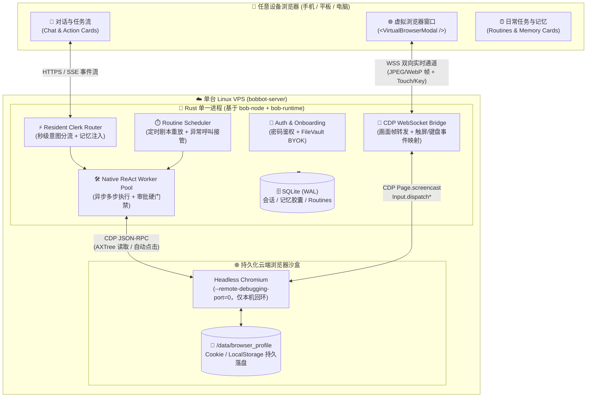

# BobBot — Architecture & Missing Technical Specs（系统架构与核心技术细节）

> **状态**：2026-11-08 架构规范。本文详细定义 `bob-bot` 如何基于 `bob-agent-next` (`v1.0.1`) 现有 Rust 内核构建，并逐一拆解**目前缺失的五大核心技术细节**及其工程实现方案。

---

## 1. 整体系统拓扑（Single-VPS Consumer Architecture）

`bob-bot` 部署在一台普通的 Linux VPS 上（无 GPU、无物理显示器，目标规格 2C/4G，2C/2G 须经 BB4 实测；测试期选用所在地区的 VPS），通过单一 Docker 容器或 `systemd` 服务对外提供 `https://bobbot.mydomain.com` 响应式网页端（支持添加至手机主屏幕作为 PWA 使用）：



---

## 2. 资产盘点：可直接复用 vs 必须新建的技术模块

| 模块层级 | 来自 `bob-agent-next` (`v1.0.1`) 可直接复用的资产 | `bob-bot` 必须新增/改造的缺失技术细节 |
| :--- | :--- | :--- |
| **网页登录与接管** | 无可直接复用的服务端：`bob-node` 没有生产 WebSocket 服务端 | **缺失细节 1（核心）**：Headless Chromium CDP 虚拟窗口推流 + 手机触屏/软键盘穿透接力 |
| **网页操控** | 无 | **缺失细节 2**：无障碍 DOM 树（AXTree）网页操控工具集 |
| **模型与运行时** | 可评估 `bob_kernel::direct_provider`。`direct_llm.rs` 绑定 Tauri，须抽取后才能用；`native_permissions` 是外部 CLI 审批中继，不可复用 | **缺失细节 3**：内置 Rust ReAct Worker、通用审批队列与持续 SSE 事件流 |
| **自动化与留存** | 无：`ScheduleItem` 只是日历条目，没有循环规则 | **缺失细节 4**：**Walkthrough-to-Routine（示教轨迹蒸馏为定时剧本）**、Cron 调度与登录态失效自愈 |
| **开箱、凭据与记忆** | `FileVaultSecretStore` 与 `ModelHubRuntime` 的设计可参考；上游网页登录由 Caddy 承担，`bob-node` 只有 Bearer 鉴权；Rust 代码中未见 FTS5 或 `dream.rs` | **缺失细节 5**：三步开箱向导、密码登录与**无感记忆胶囊（Memory Pills）** |

**复用方式**：`bob-runtime` 同时包含 `claude_harness`、DSH 等外部 CLI 模块，因此 `bob-bot` 不直接依赖该 crate，只抽取需要的最小代码。`bob-node` 是基于 `std::net` 的手写 HTTP 服务，`bobbot-server` 的 Axum + tokio 服务层属于新建工作。密钥库改用标准 AEAD（如 `ring` 的 ChaCha20-Poly1305），不沿用上游自制的加密结构。

---

## 3. 五大缺失技术细节深度设计（Implementation Blueprint）

### 🔍 缺失细节 1：手机网页内嵌“虚拟浏览器窗口”（Virtual Browser Window over CDP）

> **解决的核心问题**：VPS 没有桌面和显卡，当 Agent 遇到淘宝/X/小红书的滑块验证码、扫码登录或 2FA 短信验证时，如何让用户在手机浏览器打开 `bobbot.mydomain.com` 时，直接在一个虚拟小窗里丝滑点按并完成登录？

#### 1.1 为什么不用 VNC / WebRTC，而用 CDP Screencast？
- 传统 `Xvfb + x11vnc + noVNC` 或 `WebRTC` 需要额外跑 X Server 和视频编码器，常驻内存高，且在手机小屏上分辨率固定死板。
- **Chromium 原生 CDP (`Page.startScreencast`)** 无需 X11 虚拟显卡！Headless Chromium 直接在渲染引擎内部按指定质量（如 `format: "jpeg", quality: 65, maxWidth: 430, maxHeight: 860`）在画面发生变动时才吐出 Base64 帧，平时静止时 **0 帧率、0 带宽、0 CPU 消耗**。

#### 1.2 手机端视口自适应（Mobile-First Viewport Emulation）
当用户在手机浏览器点开虚拟窗口接管时，如果渲染 `1920×1080` 桌面网页，手机上根本看不清字也点不准滑块。
- **动态视口对齐**：前端连接 `/api/ws/browser-takeover` 时，上报当前手机画布尺寸（例如 `width: 390, height: 720, isMobile: true`）。
- 若目标站点支持移动端或响应式，后端可选通过 CDP `Emulation.setDeviceMetricsOverride` 将云端 Tab 切换为紧凑视口（如 `430×840`，`deviceScaleFactor: 2`）；若目标站点仅支持桌面端（如某些政企后台），则固定为 `1280×800`，前端 `<VirtualBrowserModal />` 提供**“双指缩放 + 焦点跟随放大镜”**模式。

#### 1.3 手机触屏与原生软键盘穿透（Touch & Soft-Keyboard Passthrough）
这是纯网页虚拟窗口能不能用爽的决定性细节：
1. **坐标精准换算**：
   前端 `<canvas>` 捕获 `pointerdown` / `pointermove` / `pointerup` 事件，按画布缩放比例换算为云端浏览器真实坐标 $(x, y)$：
   $$x_{\text{remote}} = \text{round}\left(\frac{x_{\text{client}} - \text{rect.left}}{\text{rect.width}} \times W_{\text{remote}}\right)$$
   通过 WebSocket 发送给 `bob-node`，调用 CDP `Input.dispatchMouseEvent`（或 `Input.dispatchTouchEvent`），完美支持**拖动滑块验证码**与**上下滑动页面**。
2. **手机软键盘打字（解决 `<canvas>` 无法唤起手机输入法的痛点）**：
   - 虚拟窗口顶部/底部常驻一个极简的 **「⌨️ 在此输入文字/密码并发送」** 浮动输入框（原生 `<input type="text">` / `<input type="password">`）。
   - 用户在虚拟画面里点中网页的账号框或密码框后，直接在底部原生输入框里用手机输入法打字（密码管理器按 BobBot 自身域名匹配，无法自动填充目标站点账号，需手动复制粘贴），点击「填入」，后端调用 CDP `Input.insertText` 瞬间将整段文本注入当前焦点元素，随后自动清空前端缓存，既好打字又防肩窥！

#### 1.4 接管状态机（Takeover Lifecycle）
- `IDLE`（无任务） $\rightarrow$ `AGENT_RUNNING`（Bob 自动操作，仅传文字步骤与关键截图） $\rightarrow$ `WAITING_HUMAN_TAKEOVER`（撞上登录/验证码/付款，挂起 Worker 协程，推送通知卡片） $\rightarrow$ `HUMAN_ACTIVE`（用户打开虚拟窗口实时操作，Agent 严禁同时抢鼠标） $\rightarrow$ 用户点击 **「✅ 我已处理好，交还给 Bob」** $\rightarrow$ 关闭 Screencast 推流，恢复 `AGENT_RUNNING`。
- **异常路径**：接管超时转为安全挂起；用户可取消任务；WebSocket 断开后保持 `HUMAN_ACTIVE` 并允许重连；Chromium 崩溃或服务重启后，任务根据 Step Ledger 标记为待恢复，不自动重复有副作用的步骤。
- **登录态落盘**：Chromium 延迟写盘，且会话级 Cookie 默认不跨重启保留，必须用真实站点验证「重启后仍登录」。
- **已知限制（POC 必测）**：二维码登录需要第二台设备；Passkey 无法远程使用；需验证 `<select>` 弹层、OAuth 弹窗、跨域 iframe 与文件上传。

---

### 🔍 缺失细节 2：低成本、高速度的网页自动操控引擎（DOM AXTree + Set-of-Marks）

> **解决的核心问题**：如果 Agent 每操作一步都截图发给多模态旗舰模型，既慢又贵。如何让低价模型也能快速、准确地完成复杂网页任务，并把单任务成本控制在月度上限之内？（具体成本以 BB2 实测为准。）

#### 2.1 无障碍树精简快照（Accessibility Tree Snapshot）
`bob-browser` 模块不向大模型倾倒几万行的原始 HTML，而是向当前 Tab 注入一段轻量提取脚本（或调用 CDP `Accessibility.getFullAXTree`），只提取**可见且可交互的元素**，生成带数字编号 `[id]` 的 Markdown 快照：

```text
Current URL: https://x.com/home
Page Title: Home / X
Interactive Elements:
[1] <input type="text" placeholder="Search"> (value: "")
[2] <button> "Post"
[3] <a href="/elonmusk"> "Elon Musk @elonmusk"
[4] <article> "Grok 4.6 is now live with persistent browser routines..."
```

#### 2.2 面向内置 Worker 的 6 个原子浏览器工具
只给模型暴露 6 个傻瓜化、强类型的 JSON 工具，杜绝模型胡写 CSS Selector 报错：
1. `browser_navigate(url: String)`：打开网址，等待 DOM 稳定后返回当前页面 `[id]` 元素快照。
2. `browser_click(element_id: u32)`：点击编号为 `element_id` 的元素，若触发新标签页自动切过去并返回新快照。
3. `browser_type(element_id: u32, text: String, press_enter: bool)`：在编号元素中输入文本。
4. `browser_scroll(direction: "down" | "up")`：滚动一屏并返回新露出的元素快照。
5. `browser_screenshot_inspect(question: String)`：仅当 DOM 树看不出状态（如图表、Canvas、复杂排版）时，截取当前画面交由多模态模型回答。
6. `browser_request_human(reason: String, action_type: "login" | "captcha" | "payment" | "confirm")`：**核心交接原语**！发现登录墙、验证码或高危操作时调用，挂起当前 Worker 并弹出前端虚拟浏览器小窗。

---

### 🔍 缺失细节 3：脱离外部 CLI 的内置双层异步运行时（Resident Router + Native Worker）

> **解决的核心问题**：纯消费者版本不能要求在 VPS 上安装和登录 Claude Code / Codex / DSH。`bob-bot` 必须靠自己内置的 Rust 引擎完成从秒回聊天到 25 轮异步执行的全流程。

1. **第一层：Resident Clerk（前台接待与秒级路由）**
   - 绑定用户配置的快速/低价模型（与主模型共用同一个 API Key，具体模型 ID 由内置模型注册表维护）。
   - **剥离慢速工具**：Clerk 只有两个瞬间完成的权限：① 读取用户的「记忆胶囊」与当前任务状态；② 调用 `dispatch_background_task(goal)` 派生后台 Worker（动作风险由执行层规则判定，模型不能自定安全等级）。
   - **体验效果**：用户发任何消息，界面立即显示已收到，模型回复速度取决于所选服务商。如果是闲聊或查记忆当场回答；如果是办事（“去帮我查一下…”），Clerk 立刻回复*“收到，我这就打开浏览器去帮你查，遇到需要登录我会喊你”*，同时气泡下方挂载实时进度卡片。
2. **第二层：Native ReAct Worker（后台工蜂闭环）**
   - 在 Rust `tokio::spawn` 中独立运行，支持最多 `max_steps = 25` 轮工具调用与自我纠错。
   - **持久化步骤流（Step Ledger）**：每一步工具调用（如 `🌐 打开 x.com` $\rightarrow$ `🔍 提取到 15 条推文`）实时写入 SQLite 并通过 SSE 推送到前端卡片；即使手机锁屏断网，重新打开网页也能看到最新进展。
   - **高危动作硬拦截（Action Gate Interceptor）**：在工具执行层对 URL 变化与点击目标做规则预检（例如按钮文字含 `支付 / Pay / Buy / 下单 / Delete / 删除 / 发送 / Send / 发布 / Post / 提交 / Submit`；`browser_type` 的 `press_enter=true` 同样预检；表单或发布框内无文字的图标按钮按高危处理），强制转入 `ApprovalRequest` 等待用户气泡内点选 `Allow Once`。

---

### 🔍 缺失细节 4：示教转定时日常任务（Walkthrough-to-Routine Engine）

> **解决的核心问题**：怎么让不会写代码的普通用户，把一次成功的对话变成每天稳定运行的自动化 Routine？

#### 4.1 录制与轨迹提纯（Trajectory Distillation）
当一次包含浏览器或搜索操作的任务成功完成后，任务卡片底部出现 **「✨ 存为日常任务 (Save as Routine)」** 按钮：
1. 点击后，后端提取本次 Worker 执行过程中的 **成功工具调用链（Trajectory）** 与用户的修正指令。
2. 调用 LLM 将杂乱的试错过程蒸馏为一份结构化的 `RoutinePlaybook`（存入 SQLite `routines` 表）：

```yaml
id: "routine_morning_x_digest"
title: "每日 AI 关注推文早报"
cron_expr: "0 8 * * *" # 每天早上 08:00
timezone: "Asia/Shanghai"
version: 1
missed_run_policy: "run_once_on_recovery" # 或 skip
required_domains:
  - "x.com"
steps_hint:
  - "打开 https://x.com/home 并确认已处于登录状态（若重定向至 login 则调用 browser_request_human）"
  - "向下滚动 3 屏，提取最近 12 小时内与 AI / LLM 相关的前 5 条高赞推文正文与链接"
  - "按『核心动态 + 原文链接』格式汇总为中文简报推送到主对话"
success_criteria:
  - "简报至少包含 1 条带原文链接的内容"
last_status: "success"
```

#### 4.2 定时重放与“登录态失效自愈”
- `bob-bot` 内置 Cron 调度器到点唤醒 Worker 执行 `RoutinePlaybook`。
- **异常自愈**：如果某天网站的 Cookie 过期了，Worker 调用 `browser_request_human(reason: "X.com 登录已过期，请点开虚拟窗口重新登录")`，向前端/手机推送一条待处理提醒；用户在虚拟小窗点一下登好，该次 Routine 自动补跑完成，第二天继续静默运行！
- **执行性质**：`steps_hint` 由 LLM 每次重新理解执行，是「按剧本重做」而非逐点击精确回放，结果可能波动，需用 `success_criteria` 判定。
- **保存前试运行**：保存时先跑一次试运行，高危动作只展示不执行，用户确认结果后才启用定时。
- **串行执行**：测试期所有 Worker、Routine 与人工接管共用一个浏览器 Profile，通过单任务队列串行执行。

---

### 🔍 缺失细节 5：3 分钟 BYOK 开箱向导与消费级记忆胶囊

1. **首次访问向导（First-Run Onboarding Wizard）**：
   - 检测 SQLite 中是否已完成初始化；若未初始化，访问 `bobbot.mydomain.com` 自动进入全屏三步向导：
     - **Step 1**：输入 4 位 PIN 登录。PIN 只能在服务器上设置和修改，网页端没有初始化入口，因此不存在抢先注册，也无需在日志中打印令牌。
     - **Step 2**：选择主力模型服务商（内置 DeepSeek、Google Gemini、OpenRouter、OpenAI、Anthropic 五大预设模板，自动填好 Base URL 与推荐的 Maker/Clerk 模型 ID），用户只需粘贴 1 个 API Key 并点击「验证连通性」。验证同时检查工具调用能力；不支持视觉的模型自动关闭 `browser_screenshot_inspect`。
     - **Step 3**：给你的 Bot 起个名字或选句叮嘱（可选），直接进入主界面。
2. **消费级记忆胶囊（Memory Pills）**：
   - 每当一段对话结束且闲置超过 10 分钟，后台轻量任务扫描新增对话，提取长期有价值的个人事实（如：`用户偏好：订机票喜欢靠窗`、`常用收件邮箱：xxx@gmail.com`、`正在追踪的品牌：xxx`）。
   - 存入 SQLite `memory_pills` 表（含 `id`, `category`, `fact_text`, `source_session_id`, `updated_at`）。
   - 每次对话自动将 Top 相关记忆胶囊（控制在 1.5KB 以内）注入系统提示词，并在前端「记忆与授权」Tab 以直观标签卡展示，用户随时可以一键删除错误的记忆。

---

## 4. 月度花费上限（默认 $10）

- 上限只统计模型 API 费用，不含 VPS，按用户时区的自然月计算，可在设置中调整。
- 每次模型调用后，根据服务商返回的 usage 与 model-registry 中的单价累计用量；registry 以人民币计价，按可配置汇率折算为美元；单价未知的模型不可使用。
- 达到 80% 时提醒。达到 100% 时停止所有模型调用：新任务与 Routine 不启动，运行中的 Worker 在当前步骤结束后挂起，并提示提高上限或等待下月。
- 本地统计是估算值，建议同时在模型服务商后台设置硬性额度。

## 5. 可选渠道与 MCP

- **默认全部关闭**，核心流程只依赖网页端。渠道通过统一的 `ChannelAdapter`（收消息、发文本、发审批/接管卡片）接入。
- **建议顺序**：Telegram → Lark → Discord → 微信。优先使用长轮询或长连接，避免额外暴露 Webhook。
- **微信**：个人微信 Bot 多依赖非官方协议，有封号风险，优先考虑企业微信，个人微信仅作实验选项。
- **渠道权限**：只接受已绑定的用户 ID。审批可在支持按钮的渠道内完成；登录与接管一律跳转网页虚拟窗口，禁止在聊天中收发密码。
- **MCP**：BB3 之后作为可选扩展，界面上称为「连接应用」。默认只接入远程 HTTP MCP，避免 stdio 服务引入 Node/Python 依赖；写入类工具默认需要审批。

## 6. 测试期安全基线

测试期不建设完整的提示词注入防护，由项目所有者自行承担该风险（见 PROJECT_VISION §8）。以下几项工作量小，保护的是服务器本身，测试期也保留：

1. 4 位 PIN 登录，PIN 只能在服务器上修改。PIN 只有一万种组合，因此必须在服务端限制尝试：连续错 5 次锁定 15 分钟，再次触发时时长翻倍，最长 24 小时；修改 PIN 会清除锁定并使所有设备退出登录。
2. 通过 Caddy 或同类反向代理提供 HTTPS，服务本身只监听本机地址。
3. WebSocket 校验 `Origin` 与登录会话，防止跨站劫持。
4. `browser_navigate` 禁止访问 `localhost`、内网、云元数据地址与 `file://`；CDP 仅监听本机回环地址，正式版改用管道。
5. Action Gate 保持开启。

开放给其他用户前，必须补充完整威胁模型，至少覆盖网页内容注入、跨站数据外传与按任务限制访问域名。
