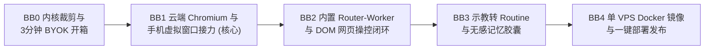

# BobBot — Development Route（分阶段开发路线图）

> **状态**：2026-11-08 制定。当前具体施工任务只看 [CURRENT_STAGE.md](CURRENT_STAGE.md)。阶段编号采用 `BB#`（BobBot Milestone），每个阶段必须通过对应的退出门（Exit Gate）实测验收后方可进入下一阶段。

---

## 阶段总览（BB0 → BB4）

| 阶段 | 核心目标 | 关键交付物 | 退出门（Exit Gate） |
| :--- | :--- | :--- | :--- |
| **BB0：内核裁剪与 BYOK 开箱底座** | 从 `bob-agent-next` 提纯单实例 `bobbot-server` 与纯净消费者前端，跑通首次访问向导 | 1. 剥离多节点/外部 CLI UI，保留极简三栏（对话 / 日常 / 记忆与网站） 2. 首次启动三步向导（设密码 + 填 API Key + 测通） 3. 凭据加密存储（标准 AEAD）与基础流式对话；Axum + tokio 服务层为新建 | 全新空库启动后，手机/电脑浏览器访问可在 3 分钟内完成密码与 API Key 配置并跑通首轮流式对话；API Key 明文零泄漏 |
| **BB1：云端 Chromium 与手机虚拟窗口接力（80% 核心价值）** | 在无显卡 Linux VPS 上跑通持久化 Chromium，并在手机网页实现可触控/可打字的虚拟窗口 | 1. `bob-browser` 守护管理（`--user-data-dir` 持久化） 2. CDP `Page.startScreencast` + WebSocket 帧推流与停止控制 3. 前端 `<VirtualBrowserModal />`：坐标精准映射、双指缩放、手机软键盘原生输入穿透 4. 网站登录态列表与一键清理 | 在所在地区的真实 VPS 上，通过手机浏览器（390px）打开虚拟窗口，逐一登录 3~5 个实际要用的办公站点并记录结果；至少一个带验证码或 2FA 的站点登录成功；重启服务后仍保持已登录状态。被站点拒绝的情况如实记录，不绕过风控 |
| **BB2：内置 Router-Worker 与 DOM 网页自动操控** | 彻底摆脱外部 CLI 依赖，让 Bob 自己看懂网页、点按钮、遇到阻碍喊人接管 | 1. 无障碍 DOM 树（AXTree + `[id]` 编号）提取脚本 2. 6 个原子浏览器工具（`navigate`/`click`/`type`/`scroll`/`inspect`/`request_human`） 3. Resident Clerk + Native ReAct Worker 异步循环与高危点击审批卡 4. 月度花费上限（默认 $10） | 用自然语言下达跨页网页任务，Worker 自动提取 DOM 完成跳转与信息抓取；撞上未登录页面时自动暂停并弹出 BB1 的虚拟窗口，用户登完点“交还”后 Worker 自动跑完剩余步骤；用量达到上限后不再发起模型调用 |
| **BB3：示教转 Routine 与无感记忆胶囊** | 复刻并超越 Grok Bot 的 Routines 留存体验与抗衰减记忆 | 1. 任务卡片「存为日常任务」轨迹提纯器（生成 `RoutinePlaybook`） 2. 内置 Cron 调度器与登录失效自愈提醒 3. 闲置对话自动蒸馏 `memory_pills` 并在「记忆」Tab 可视化管理 4. 可选通知渠道（首个：Telegram），Lark / Discord / 微信 / MCP 按需追加 | 完成一次手动辅助的网页信息汇总后，一键存为定时任务；触发定时执行能自动复用登录态跑出新一期简报；记忆胶囊可正常生成与删除 |
| **BB4：单 VPS 一键部署打包（Docker & Systemd）** | 让任何消费者租一台 VPS 就能 1 条命令跑起来 | 1. 包含 `bobbot-server` + `chromium` + 中文字体的轻量 `Dockerfile` 2. 内存保护（Chromium 空闲自动关闭标签页回收内存，总内存 `<600MB`） 3. 完整 `USER_GUIDE.md` | 在一台干净的 2C/4G Linux VPS 上一键拉起服务，连续运行 24 小时无僵尸进程、无内存泄漏 |
